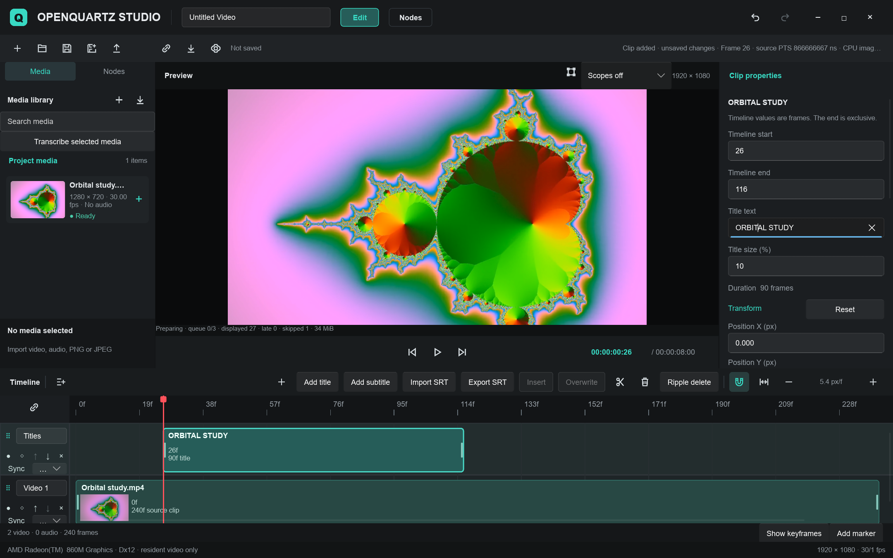
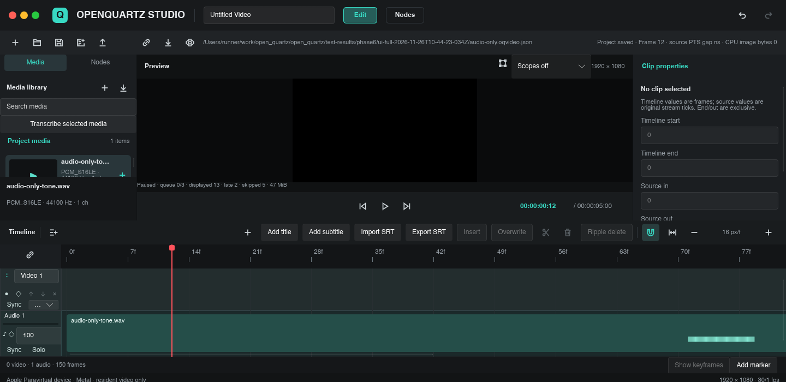
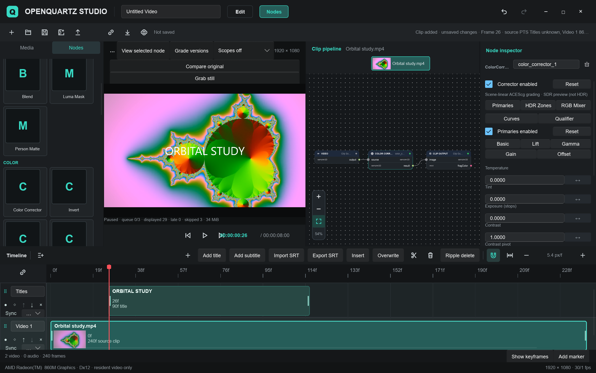

# OpenQuartz Studio

[](https://www.rust-lang.org/) [](https://slint.dev/) [](https://wgpu.rs/) [](https://ffmpeg.org/) [](https://github.com/sanitor/oq-studio/actions/workflows/ci.yml) [](LICENSE)

**A native, non-destructive video editor for Windows and macOS.** Cut on a multitrack timeline, grade and composite with per-clip GPU node graphs, and turn spoken media into an editable rough cut with local AI.

[Download the desktop preview](https://github.com/sanitor/oq-studio/releases) · [中文使用文档](apps/open_quartz_video_editor/README.md) · [Roadmap](apps/open_quartz_video_editor/TODO.md)



## Highlights

### Cross-platform desktop editing

The same Studio project format and editing workflow are available on **Windows x64** and **Apple Silicon macOS**. Projects preserve source media references and sequence settings. Media relinking matches originals by content fingerprint when assets move.

| Windows x64 | Apple Silicon macOS |
| --- | --- |
|  |  |
| Direct3D 12 backend and D3D12VA video decode | Metal backend and VideoToolbox video decode |

### Native GPU performance

Studio uses Rust and Slint for the desktop interface, wgpu for rendering, and [oq-media](https://github.com/sanitor/oq-media) with FFmpeg for timestamp-accurate media access. Supported hardware video frames stay on the GPU for preview and compositing. Playback uses a bounded frame window, and proxy media helps with heavier projects.


*8K playback diagnostics from a Windows Radeon test using synthetic footage. Frame delivery depends on the hardware, footage and effects. See the [8K measurement notes](apps/open_quartz_video_editor/DESIGN.md#912-8k实测与可复跑证据2026-11-20) for the test setup and results.*

### Local AI for editing and compositing

- **Transcribe and cut by text.** Run Whisper locally, search recognized dialogue, jump to the source timestamp, and turn selected segments into a rough cut with linked audio and editable subtitles.
- **Isolate a person in the node graph.** Add Person Matte to composite a foreground subject over another video track.


*Local Whisper transcription of a short excerpt from John F. Kennedy's inaugural address. Setup requires a local CLI and model. See the [transcription guide](apps/open_quartz_video_editor/README.md#本地转录与文本粗剪).*

### Professional editing, grading and delivery

| Workflow | Studio tools |
| --- | --- |
| **Edit** | Source In/Out, insert and overwrite, ripple and roll, slip and slide, nested sequences and synchronized multicam switching |
| **Grade and composite** | Per-clip node graphs, ACEScg, scopes, CUBE LUTs, grade versions, shared track and timeline adjustments, and tracked polygon masks |
| **Finish and deliver** | SRT, OTIO timeline exchange, ProRes 422 HQ, H.264 and HEVC MP4, plus 24-bit PCM stems with LUFS and true-peak reporting |



*Clip-level Color Corrector and the program monitor in the Nodes workspace. The [editor guide](apps/open_quartz_video_editor/README.md) documents codec support and the current OTIO and HDR boundaries.*

## Get Studio

Download the appropriate archive from [GitHub Releases](https://github.com/sanitor/oq-studio/releases), then extract the entire archive.

| Platform | Launch |
| --- | --- |
| Windows x64 | Run `open_quartz_video_editor.exe` from the extracted folder. |
| macOS Apple Silicon | Open `OpenQuartz Studio.app` from the extracted archive. |

## Build from source

Use a supported desktop host with Rust **1.92 or later** and Node.js **22**. On Windows, install the MSVC C++ build tools and LLVM for FFmpeg bindings. The scripts prepare the native media runtime.

```sh
npm ci
npm run dev:video-editor
npm run test:video-editor:portable
npm run package:video-editor
```

The package command writes the verified desktop archive to `dist-desktop/`. See the [detailed setup and hardware test guide](apps/open_quartz_video_editor/README.md).

## Project and license

Studio uses the [OpenQuartz graph runtime](https://github.com/sanitor/open_quartz), [oq-media](https://crates.io/crates/oq-media) and [slint_code_editor](https://crates.io/crates/slint_code_editor). Studio source is licensed under [MIT](LICENSE). Distributed third-party components retain their own license notices.
