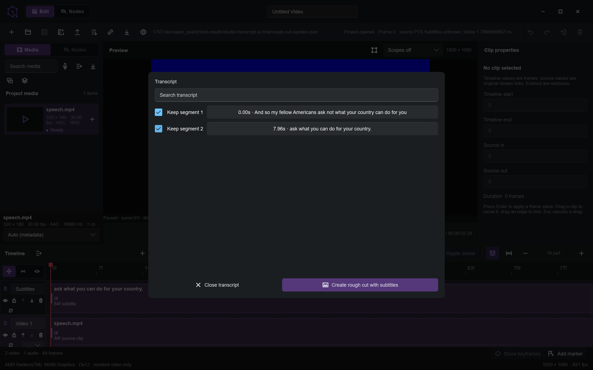
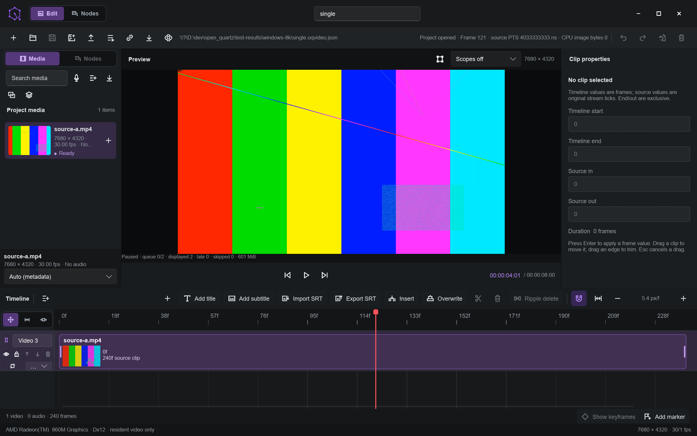

# OpenQuartz Studio

[](https://www.rust-lang.org/) [](https://slint.dev/) [](https://wgpu.rs/) [](https://ffmpeg.org/) [](https://github.com/sanitor/oq-studio/actions/workflows/ci.yml) [](LICENSE)

**A cross-platform video editor built for native GPU performance and local AI.** Cut on a non-destructive multitrack timeline, grade and composite with per-clip node graphs, and turn dialogue into an editable rough cut.

Studio targets desktop and mobile platforms. The desktop preview is available for **Windows x64** and **Apple Silicon macOS**. Mobile support is planned across platforms, including iOS, iPadOS and Android.

[Download the desktop preview](https://github.com/sanitor/oq-studio/releases) · [中文使用文档](apps/open_quartz_video_editor/README.md) · [Roadmap](apps/open_quartz_video_editor/TODO.md)


## Highlights

### Edit and organize

- **Work with a shared media library.** Import video, audio and stills, search project media, mark source In/Out points, and relink moved originals by content fingerprint. Autosave recovery and previous project versions help recover edits.
- **Cut with a multitrack timeline.** Insert or overwrite, trim and ripple, roll a cut, slip or slide a clip, and keep linked audio in sync. Organize edits with markers, nested sequences and synchronized multicam switching.
- **Build motion and titles.** Animate position, scale, rotation, crop, opacity and effect parameters. Use blend modes, dissolves, speed changes, titles and editable subtitles.

### Grade and composite

- **Build a GPU graph for each clip.** Search the node catalog, preview effects on thumbnail tiles, connect branches, and monitor intermediate nodes or final output. Add built-in color, filter, distortion and blend nodes, or write a custom WGSL shader.
- **Grade and compare shots.** Use ACEScg color management, primaries, HDR zones, channel curves, RGB mixing, CUBE LUTs and scopes. Compare against the original or a saved still, copy grades between clips, and keep alternate grade versions.
- **Shape and track a composite.** Combine layers and mattes, track feathered masks, correct tracking drift, and apply shared exposure or saturation adjustments across a track or sequence.


### Local AI for editing and compositing

- **Transcribe and cut by text.** Run Whisper locally, search recognized dialogue, jump to the source timestamp, and turn selected segments into a rough cut with linked audio and editable subtitles.
- **Isolate a person in the node graph.** Add Person Matte to composite a foreground subject over another video track.



*Local Whisper transcription of a short excerpt from John F. Kennedy's inaugural address. Setup requires a local CLI and model. See the [transcription guide](apps/open_quartz_video_editor/README.md#本地转录与文本粗剪).*

### Mix and deliver

- **Edit and mix audio.** Work with linked or independent audio, waveforms, fades, crossfades, clip gain, track mute and solo, and level meters.
- **Export and exchange.** Queue H.264 SDR or HEVC HDR MP4 exports, create ProRes 422 HQ SDR masters, and deliver 24-bit PCM mixes and stems with LUFS and true-peak reporting. Import or export SRT subtitles and exchange supported timeline edits with OTIO.

See the [editor guide](apps/open_quartz_video_editor/README.md) for codec support, OTIO coverage and HDR delivery limits.

### Native GPU playback

Studio uses Rust and Slint for the interface, wgpu for rendering, and oq-media with FFmpeg for timestamp-accurate media access. Supported decoded frames stay on the GPU for preview and compositing. Playback uses a bounded frame window, and background proxy generation can make demanding projects easier to edit.



*8K preview with synthetic footage on Windows. Frame delivery depends on the hardware, footage and effects. See the [8K measurement notes](apps/open_quartz_video_editor/DESIGN.md#912-8k实测与可复跑证据2026-11-20) for benchmark setup and results.*

## Get Studio

Download the appropriate archive from [GitHub Releases](https://github.com/sanitor/oq-studio/releases), then extract the entire archive.

| Platform | Launch |
| --- | --- |
| Windows x64 | Run `open_quartz_video_editor.exe` from the extracted folder. Uses Direct3D 12 and D3D12VA. |
| macOS Apple Silicon | Open `OpenQuartz Studio.app` from the extracted archive. Uses Metal and VideoToolbox. |

## Build from source

Use a supported desktop host with Rust **1.92 or later** and Node.js **22**. On Windows, install the MSVC C++ build tools and LLVM for FFmpeg bindings. The scripts prepare the native media runtime.

```sh
npm ci
npm run dev:video-editor
npm run test:video-editor:portable
npm run package:video-editor
```

The package command writes the verified desktop archive to `dist-desktop/`. See the [detailed setup and hardware test guide](apps/open_quartz_video_editor/README.md).

## Project and license

Studio uses the [OpenQuartz graph runtime](https://github.com/sanitor/open_quartz), [oq-media](https://crates.io/crates/oq-media) and [slint_code_editor](https://crates.io/crates/slint_code_editor). Studio source is licensed under [MIT](LICENSE). Distributed third-party components retain their own license notices.
